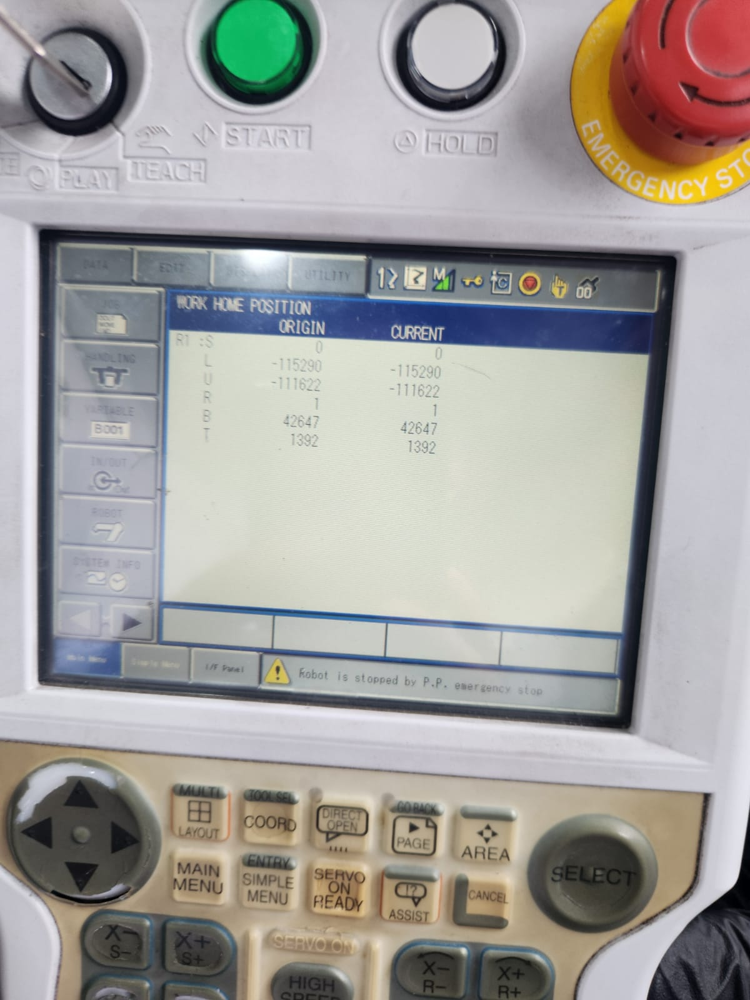
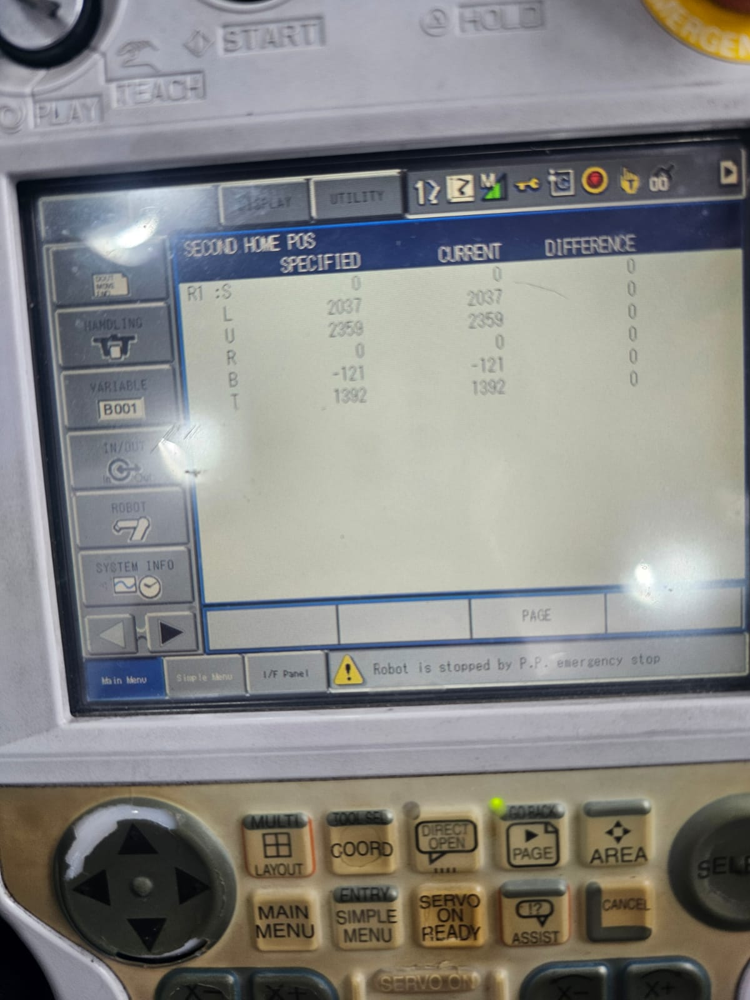

# Configuraciones Iniciales: Home 1 y Home 2 (Motoman MH6)

## Tabla comparativa de posiciones articulares

| Articulación | Eje / Función | Home 1 (`WORK HOME POSITION`) [pulsos] | Home 2 (`SECOND HOME POS`) [pulsos] |
| :--- | :--- | :---: | :---: |
| **S** | Base giratoria (Swing) | `0` | `0` |
| **L** | Brazo inferior (Lower Arm) | `-115290` | `2037` |
| **U** | Brazo superior (Upper Arm) | `-111622` | `2359` |
| **R** | Rotación de antebrazo (Roll) | `1` | `0` |
| **B** | Inclinación de muñeca (Bend) | `42647` | `-121` |
| **T** | Giro de brida/herramienta (Twist) | `1392` | `1392` |

**Home 1 (`WORK HOME POSITION`)**

Esta configuración repliega completamente los eslabones principales (L y U) hacia la base del manipulador mediante conteos negativos altos. Al adoptar una geometría recogida, el robot ocupa el menor volumen posible dentro de la celda y concentra su masa cerca del eje vertical de giro (S). Esto reduce significativamente su momento de inercia y los pares gravitacionales sobre los actuadores inferiores, evitando esfuerzos mecánicos innecesarios cuando el equipo está detenido o en traslado.

**Home 2 (`SECOND HOME POS`)**
Esta configuración ubica las articulaciones en valores cercanos al origen mecánico de cero pulsos, dejando el brazo erguido y desplegado en ángulo recto frente al área de trabajo. Al mantener el efector final elevado y despejado de la estructura propia del robot, proporciona la mejor postura inicial para comenzar cualquier rutina, garantizando alcance inmediato y libre de colisiones hacia la mesa de trazado.

**¿Cuál es mejor?**

Para transporte, embalaje y almacenamiento la mejor posición es Home 1, ya que su postura compacta minimiza el espacio requerido y su bajo momento de inercia protege la estructura y los reductores durante el traslado o reposo prolongado.
Por otro lado para la ejecución de trayectorias la mejor posición es Home 2,ya que es la postura óptima para iniciar y finalizar el trabajo sobre la superficie, reduciendo los tiempos de desplazamiento y facilitando la maniobrabilidad hacia los puntos de la trayectoria.
